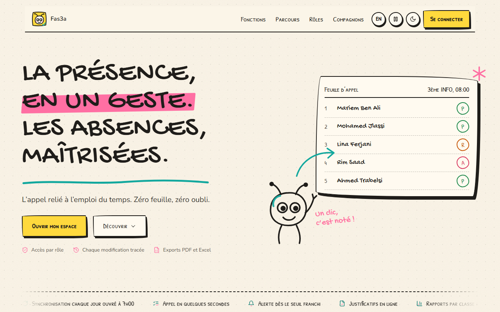
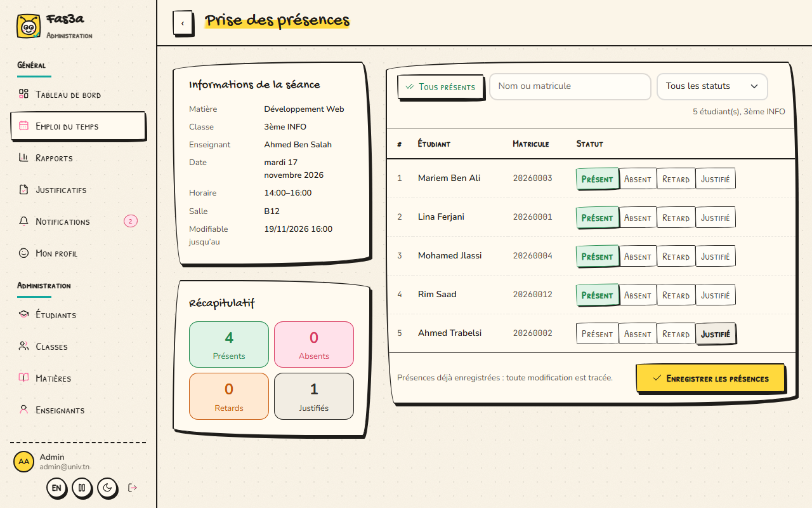
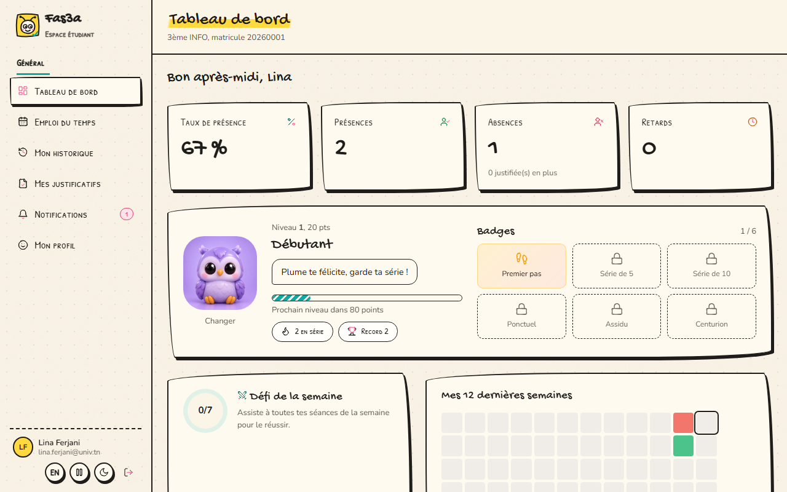

  

<h1 align="center">Fas3a</h1>

  Class attendance for universities, drawn like a notebook. 
  <a href="https://attendflow-bwr9.onrender.com"><b>Try it online</b></a>

  

Fas3a replaces the paper attendance sheet. Sessions are imported every morning from the university timetable
(simulated in this version), the teacher marks who is there in a few taps, and everyone sees the same numbers:
the admin, the teacher and the student.

## What each person can do

**Teacher**
- Takes attendance for their own sessions once a session has started, and can fix it for a while after
- Sees today's sessions and the attendance rate of their classes
- Approves or refuses absence notes for their classes

**Student**
- Follows their attendance rate, absences and lateness
- Sends an absence note (PDF or photo) and sees if it was accepted
- Gets a companion, levels and badges that grow with their attendance

**Admin**
- Manages students, teachers, classes and subjects (students can also be imported from Excel or CSV)
- Sets the absence limits and how long teachers can edit attendance
- Gets an alert when a student goes over the limit
- Exports reports as PDF or Excel

  
  

The whole app works in French and English, with a light "paper" theme and a dark "chalkboard" one.

## Try it

The online version runs on a free server, so the first visit can take a minute to wake up.
Ask me for the demo passwords.

| Role | Email |
|---|---|
| Admin | `admin@univ.tn` |
| Teacher | `ahmed.bensalah@univ.tn` |
| Student | `lina.ferjani@univ.tn` |

New accounts created by the admin have no password yet: the person picks one with "Mot de passe oublié ?".

## Run it on your computer

You need Java 25 and PostgreSQL.

1. Create an empty database called `attendflow`.
2. Set `DB_PASSWORD` (and `DB_USERNAME` if it isn't `postgres`).
3. Start the app with `./mvnw spring-boot:run` and open http://localhost:8081

The first start fills the app with example classes, teachers and students.
Emails (password reset, alerts) are caught locally by [Mailpit](https://mailpit.axllent.org) at http://localhost:8025.

Tests run with `./mvnw test` and need nothing else installed.

## Made with

Java and Spring Boot, Thymeleaf pages, PostgreSQL, Bootstrap, Chart.js for the charts and GSAP for the animations.
